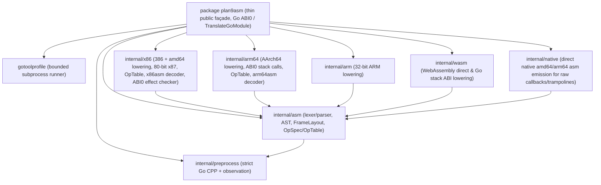

# `plan9asm` Architecture

`github.com/xgo-dev/plan9asm` translates Go / Plan 9 assembly (`.s`) into LLVM IR (or direct native assembly for raw register trampolines).

Its modular structure mirrors Go's own assembler toolchain — `cmd/asm` (preprocessor + parser) and `cmd/internal/obj/{x86,arm64,arm,wasm}` (per-architecture lowering backends) — targeting **LLVM IR** instead of raw machine code.

## Package Layout & Dependency DAG

### Why per-architecture packages?

1. **Bounded single-package compilation units**: Each backend compiles into its own Go package and LLVM module. During LLGo self-hosting (`llgo build ./cmd/llgo`), peak single-package SSA size stays at **~53k instructions** (`internal/x86`) and the root `plan9asm` façade is only **~13k SSA instructions**, keeping cold self-host peak RSS around **4.1–4.5 GiB** (vs. >14 GiB OOM when all architectures and generated instruction tables live in one monolithic package).
2. **Zero external API churn**: Root `package plan9asm` re-exports all public types, constants, and functions (`aliases.go`, `translate.go`, `go_translate.go`, `arm64_tail.go`, `amd64_frame.go`, `go_assembly_header.go`) while isolating internal architecture state.
3. **Independent incremental builds and tests**: Changes to `internal/x86` do not invalidate `internal/arm64`, `internal/arm`, `internal/wasm`, `internal/preprocess`, or `internal/native`.

## Declarative ISA Engine & Scaling to Full Instruction Set Coverage

Go's `cmd/internal/obj/{x86,arm64}` scales to thousands of instructions without millions of lines of hand-written code by separating **declarative opcode metadata** (`optab`) from **parameterized semantic lowering**. `plan9asm` adopts the same pattern:

1. **Shared `OpSpec` / `OpTable` (`internal/asm/opspec.go`)**:
   - Each instruction entry declares its opcode family (`FamilyMove`, `FamilyALU`, `FamilyVecBinOp`, `FamilyCrypto`, `FamilySystem`, ...), operand width, lane geometry, read/write/zero-upper register effects (`OpEffect`), flags behavior (`FlagsBehavior`), target feature requirement (`ArchFeature`), and LLVM IR opcode / intrinsic.
2. **Parameterized family lowerers**:
   - Instead of writing one custom switch case per instruction (e.g., separate handlers for `VPADDB`/`VPADDW`/`VPADDD`/`VPADDQ`/`VPSUB*`/`VPMULL*`/`VPMIN*`/`VPMAX*`/`VADDPS`/`VADDPD` across XMM/YMM/ZMM widths), a single parameterized family lowerer (`lowerDeclarativeVecBinOp` in `internal/x86/ops.go`) reads `OpSpec` and emits typed LLVM vector IR across 128-, 256-, and 512-bit registers automatically.
   - Adding a new instruction family member is a **1-line table row** in `internal/<arch>/ops.go`.
3. **Table-driven ABI0 effect & provenance checking (`internal/x86/effects.go`)**:
   - `CheckABI0ResultInitWithSigs` queries `OpTable` directly to verify register initialization, private `SP` confinement, outgoing ABI0 stack arguments/results, and result slot initialization — new `OpTable` entries automatically participate in effect checking with zero duplicate per-opcode boilerplate.
4. **Raw encoding decoder bridge (`golang.org/x/arch`)**:
   - Real Go assembly frequently emits raw machine-code directives (`BYTE`, `WORD`, `LONG`, `QUAD`) for newer ISA extensions.
   - `internal/x86/raw.go` decodes `BYTE`/`WORD`/`LONG`/`QUAD` runs using a compact VEX table plus `golang.org/x/arch/x86/x86asm`, and `internal/arm64/raw.go` decodes AArch64 `WORD` instructions via `golang.org/x/arch/arm64/arm64asm`, feeding canonical Plan 9 `asm.Instr` values (marked `DecodedFromRaw: true` for provenance enforcement) directly into the normal lowering pipeline.

## Key Subsystems

- **Strict Go Assembly Preprocessor (`internal/preprocess`)**: Bounded `#include`/`#define`/`#ifdef` evaluation compatible with Go's `cmd/asm`, including structured observation (`ObserveAssemblyCPP`) and toolchain macro profiles (`GoAssemblerDefinesForEnvironment`).
- **80-bit x87 Lowering (`internal/x86/lower_x87.go`)**: Models x87 registers as 80-bit IEEE 754 binary80 (`{ i64, i16 }`), emitting hardware 80-bit inline asm (`fldt`/`frndint`/`fstpt`/`fistpll`) in `X87Auto`/`X87Hardware` mode and pure-integer bit-exact binary80 software IR (requiring explicit control-word initialization via `FINIT`/`FLDCW`) in `X87Software` mode.
- **Physical Frame & Tail Binding (`amd64_frame.go`, `arm64_tail.go`, `go_translate.go`)**:
  - `GoAMD64FrameSource` verifies selected Go/assembly source snapshots via `gotoolprofile.RunBounded` and attaches live leases (`FuncSig.FrameLease`).
  - `BindGoARM64ABI0TailDeclarations` validates complete selected Go source inventories before binding ARM64 ABI0 private `helper<>` tail targets.
  - `internal/arm64` and `internal/x86` both back physical `SP`/`RSP` frames with byte-addressable `%local_stack` allocas and marshal ABI0 outgoing stack `CALL` arguments/results (accounting for ARM64's 8-byte saved-LR slot at `0(RSP)`).
- **Direct Native Backend (`internal/native`)**: Emits native assembly directly for bounded amd64/arm64 raw callback/trampoline files without synthesizing fake Go/LLVM signatures.
