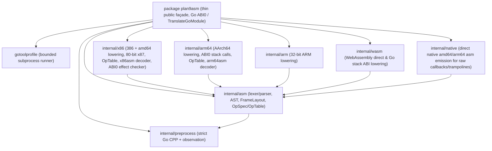

# `plan9asm` Architecture

`github.com/xgo-dev/plan9asm` translates Go / Plan 9 assembly (`.s`) into LLVM IR (or direct native assembly for raw register trampolines).

Its modular structure mirrors Go's own assembler toolchain — `cmd/asm` (preprocessor + parser) and `cmd/internal/obj/{x86,arm64,arm,wasm}` (per-architecture lowering backends) — targeting **LLVM IR** instead of raw machine code.

## Package Layout & Dependency DAG

### Why per-architecture packages?

1. **Bounded single-package compilation units**: Each backend compiles into its own Go package and LLVM module. During LLGo self-hosting (`llgo build ./cmd/llgo`), peak single-package SSA size stays at **~53k instructions** (`internal/x86`) and the root `plan9asm` façade is only **~13k SSA instructions**, keeping cold self-host peak RSS around **4.1–4.5 GiB** (vs. >14 GiB OOM when all architectures and generated instruction tables live in one monolithic package).
2. **Zero external API churn**: Root `package plan9asm` re-exports all public types, constants, and functions (`aliases.go`, `translate.go`, `go_translate.go`, `arm64_tail.go`, `amd64_frame.go`, `go_assembly_header.go`) while isolating internal architecture state.
3. **Independent incremental builds and tests**: Changes to `internal/x86` do not invalidate `internal/arm64`, `internal/arm`, `internal/wasm`, `internal/preprocess`, or `internal/native`.

## Declarative ISA Engine & Scaling to Full Instruction Set Coverage

Go's `cmd/internal/obj/{x86,arm64,arm}` scales to thousands of instructions without hundreds of thousands of lines of hand-written code by separating **declarative opcode metadata** (`optab`) from **parameterized semantic lowering**. `plan9asm` adopts the same pattern:

1. **Shared `OpSpec` / `OpTable` (`internal/asm/opspec.go`)**:
   - Each instruction entry declares its opcode family (`FamilyMove`, `FamilyALU`, `FamilyShift`, `FamilyBit`, `FamilyMulDiv`, `FamilyAtomic`, `FamilyFP`, `FamilyMask`, `FamilyVecBinOp`, `FamilyVecUnary`, `FamilyVecShift`, `FamilyVecShuffle`, `FamilyCrypto`, `FamilySystem`, ...), operand width (`Width`/`SrcWidth`), lane geometry (`LaneBits`), read/write/zero-upper register effects (`Effect`), implicit register usage (`Implicit`), flags behavior (`Flags`), target feature requirement (`ArchFeature`), and LLVM IR opcode / intrinsic / inline asm template.
   - The three native lowering backends (`internal/arm/ops.go`, `internal/arm64/lower_*_declarative.go`, `internal/x86/ops.go` + `lower_*_declarative.go`) register static `OpSpec` tables queried in O(1) via `asm.OpTable`.
2. **Parameterized family lowerers**:
   - Instead of writing one custom switch case per instruction (e.g., separate handlers for `VPADDB`/`VPADDW`/`VPADDD`/`VPADDQ`/`VPSUB*`/`VPMULL*`/`VPMIN*`/`VPMAX*`/`VADDPS`/`VADDPD` across XMM/YMM/ZMM + EVEX K-mask + `.Z` + `.BCST`, or AArch64 LSE atomics `{LDADD,LDCLR,LDEOR,LDOR,LDSMAX,LDSMIN,LDUMAX,LDUMIN,SWP,CAS} × {,A,L,AL} × {B,H,W,D}`, or NEON vector arithmetic across `.B8/.B16/.H4/.H8/.S2/.S4/.D2`), each family has one parameterized emitter that derives LLVM types, lane counts, and masking directly from `OpSpec`.
   - Adding a new instruction family member is a **1-line table row** with zero SSA bloat.
3. **Automatic LLVM intrinsic declaration (`internal/asm/intrinsics.go`)**:
   - `CollectMissingLLVMIntrinsicDecls` scans emitted function bodies right before module assembly and emits deterministic `declare ...` lines for any `@llvm.*` intrinsic calls not already in the target prelude (`@llvm.sadd.sat.*`, `@llvm.abs.*`, `@llvm.ctpop.*`, `@llvm.bitreverse.*`, `@llvm.fshl.*`, `@llvm.fma.*`, `@llvm.roundeven.*`, `@llvm.x86.*`, etc.).
   - Backends never maintain giant hand-copied intrinsic preludes or risk undeclared-intrinsic LLVM verifier errors.
4. **Table-driven ABI0 effect & provenance checking (`internal/x86/effects.go`)**:
   - `CheckABI0ResultInitWithSigs` queries `OpTable` directly to verify register initialization, private `SP` confinement, outgoing ABI0 stack arguments/results, and result slot initialization — new `OpTable` entries automatically participate in effect checking with zero duplicate per-opcode boilerplate.
5. **Raw encoding decoder bridge (`golang.org/x/arch`)**:
   - Real Go assembly frequently emits raw machine-code directives (`BYTE`, `WORD`, `LONG`, `QUAD`) for newer ISA extensions.
   - `internal/x86/raw.go` decodes `BYTE`/`WORD`/`LONG`/`QUAD` runs using a compact VEX table plus `golang.org/x/arch/x86/x86asm`, and `internal/arm64/raw.go` decodes AArch64 `WORD` instructions via `golang.org/x/arch/arm64/arm64asm`, feeding canonical Plan 9 `asm.Instr` values (marked `DecodedFromRaw: true` for provenance enforcement) directly into the normal lowering pipeline.

## Fast Ecosystem Scanning & Coverage Iteration Loop

To close third-party Go library assembly gaps quickly without slow `go mod download` / `go/packages` / `llc` loops, `plan9asm` ships two fast in-memory audit workflows:

1. **Remote module ZIP streaming audit (`cmd/plan9asmdiscover -audit`)**:
   - Streams `.s` entries directly from Go module proxy ZIPs via HTTP `Range` requests (`remoteZipReaderAt`), parses them in-memory with `plan9asm.Parse`, and probes instructions with a deduplicated `(goarch, form)` cache (`ProbeInstruction`).
   - Supports `-modules=<csv|@file>` to target curated third-party libraries directly (skipping `index.golang.org`) and outputs a frequency-ranked `audit.top_gaps` list grouped by `(arch, opcode, form, error, hits, module_count, example)`.
2. **Local directory / `$GOMODCACHE` scan (`cmd/plan9asmscan -corpus=dir -input=<dir>`)**:
   - Walks any local repo, monorepo, or `$GOMODCACHE` directly in-memory, matching `.s` files to `GOARCH` via filename suffixes and `//go:build` directives, and produces the same structured Markdown/JSON (`-format=md|json`) form-coverage report used for Go's official assembler corpus (`-corpus=go-asm`).

## Key Subsystems

- **Strict Go Assembly Preprocessor (`internal/preprocess`)**: Bounded `#include`/`#define`/`#ifdef` evaluation compatible with Go's `cmd/asm`, including structured observation (`ObserveAssemblyCPP`) and toolchain macro profiles (`GoAssemblerDefinesForEnvironment`).
- **80-bit x87 Lowering (`internal/x86/lower_x87.go`)**: Models x87 registers as 80-bit IEEE 754 binary80 (`{ i64, i16 }`), emitting hardware 80-bit inline asm (`fldt`/`frndint`/`fstpt`/`fistpll`) in `X87Auto`/`X87Hardware` mode and pure-integer bit-exact binary80 software IR (requiring explicit control-word initialization via `FINIT`/`FLDCW`) in `X87Software` mode.
- **Physical Frame & Tail Binding (`amd64_frame.go`, `arm64_tail.go`, `go_translate.go`)**:
  - `GoAMD64FrameSource` verifies selected Go/assembly source snapshots via `gotoolprofile.RunBounded` and attaches live leases (`FuncSig.FrameLease`).
  - `BindGoARM64ABI0TailDeclarations` validates complete selected Go source inventories before binding ARM64 ABI0 private `helper<>` tail targets.
  - `internal/arm64` and `internal/x86` both back physical `SP`/`RSP` frames with byte-addressable `%local_stack` allocas and marshal ABI0 outgoing stack `CALL` arguments/results (accounting for ARM64's 8-byte saved-LR slot at `0(RSP)`).
- **Direct Native Backend (`internal/native`)**: Emits native assembly directly for bounded amd64/arm64 raw callback/trampoline files without synthesizing fake Go/LLVM signatures.
